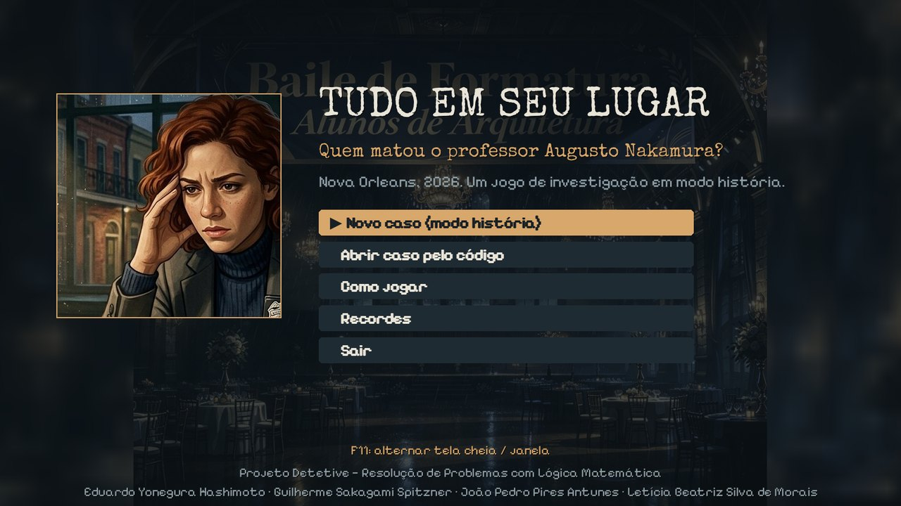
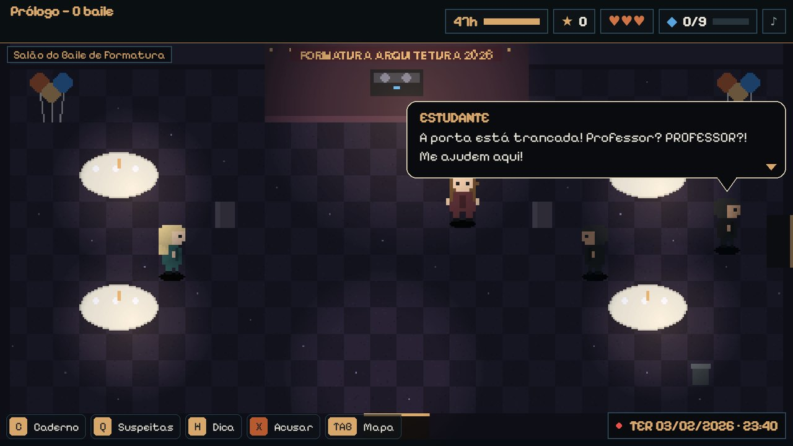
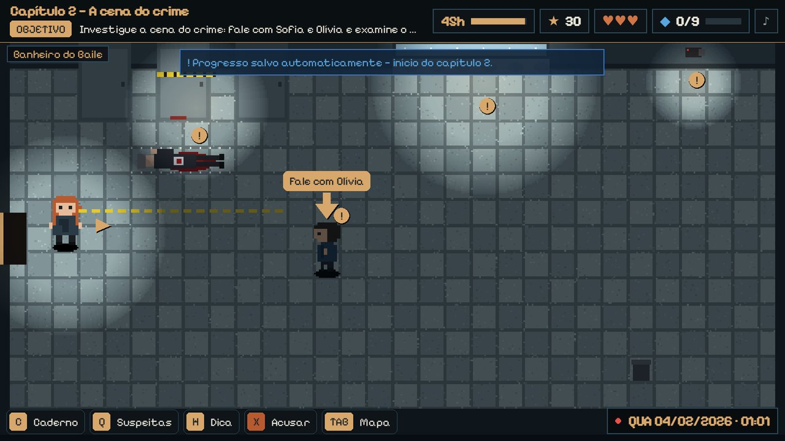
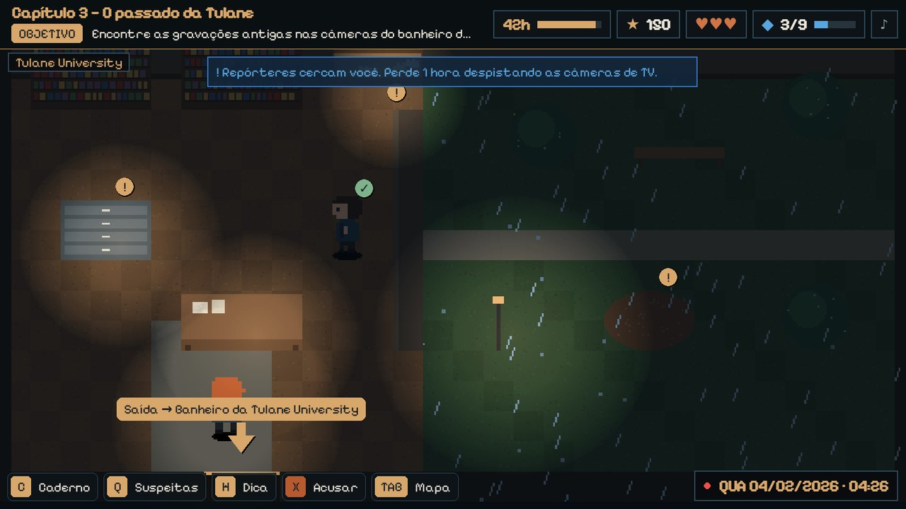
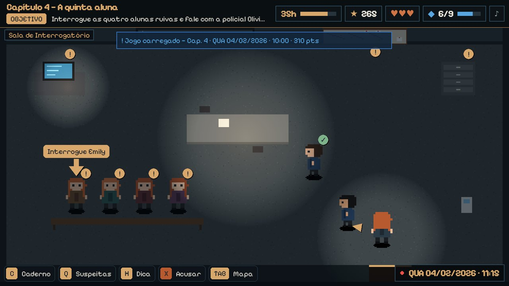
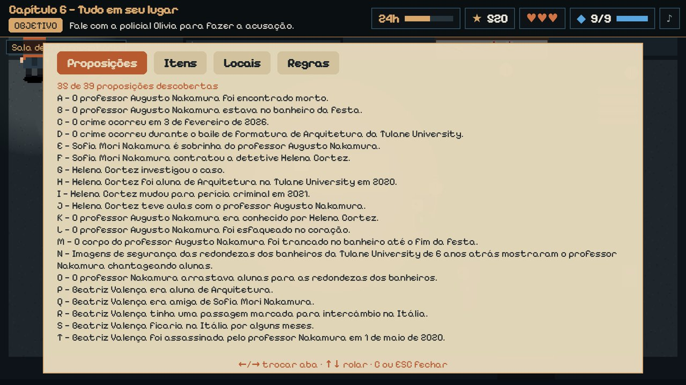
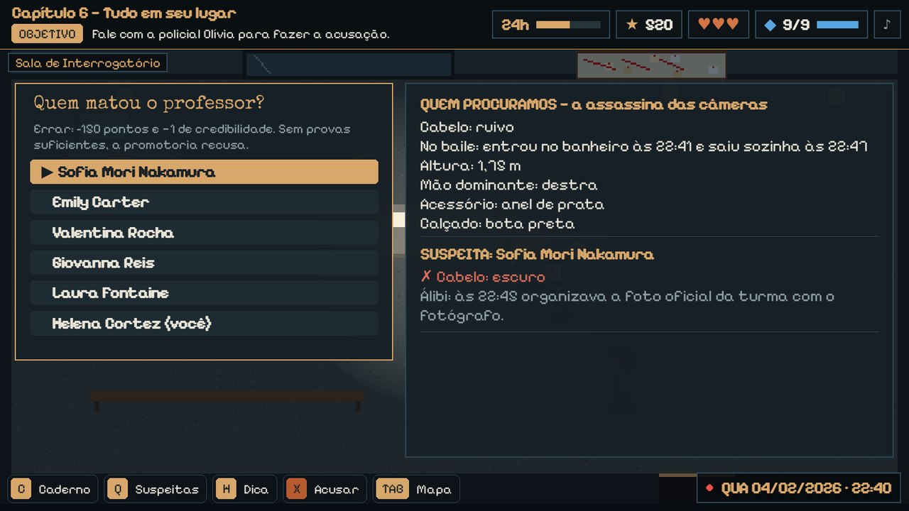
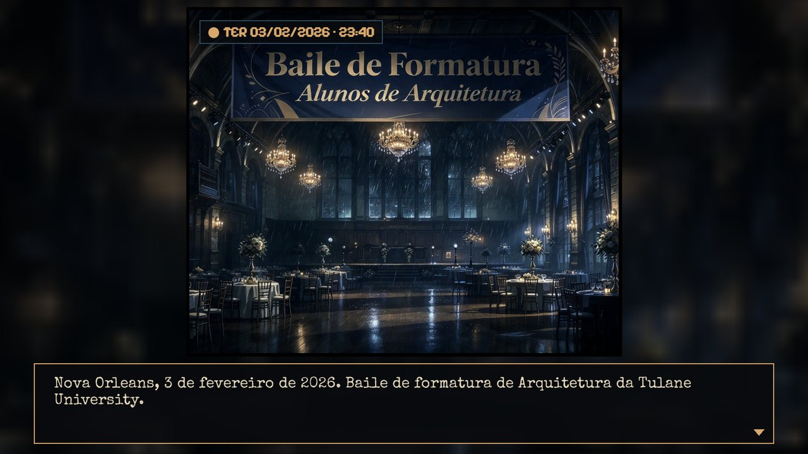
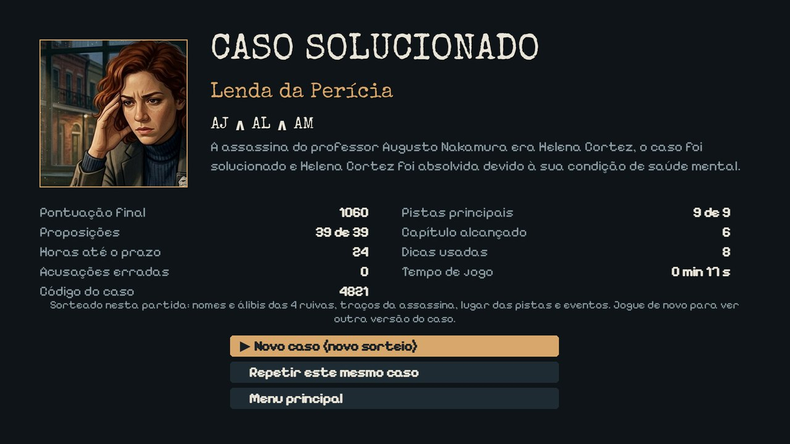

<div align="center">

# 🔎 Tudo em seu Lugar

**Jogo de investigação em modo história, feito em Python + pygame.**
Quem matou o professor Augusto Nakamura no baile de formatura da Tulane University?


[](https://github.com/jpiresantunes29-dotcom/tudo-em-seu-lugar/actions/workflows/testes.yml)



</div>

## Sobre

*Tudo em seu Lugar* é o jogo do **Projeto DETETIVE (RA2)** da disciplina de
**Resolução de Problemas com Lógica Matemática** da **PUCPR**. O caso
(personagens, locais, itens, proposições e conclusão lógica) foi criado pela
equipe nos slides do trabalho, e o jogo transforma essa história numa
investigação jogável.

Você controla a detetive **Helena Cortez**: anda pelos cenários em pixel art,
examina pistas, conversa com os personagens, interroga suspeitas e, no fim,
precisa dizer **quem** matou o professor e **por quê**. Uma partida completa dura
cerca de **15 a 17 minutos**.

## Destaques

- **Modo história em 7 capítulos**, com cenas, diálogos em balões, imagens em tela cheia e um relógio que acompanha a data e a hora de cada momento do caso.
- **Ilustrações da equipe** usadas nas cenas, nas fichas e nos retratos dos personagens.
- **Partidas diferentes a cada vez**: nomes, idades, profissões e álibis das suspeitas, traços da assassina nas câmeras, lugar das pistas, pistas falsas e eventos são sorteados. Um *código do caso* permite repetir a mesma partida.
- **Decisões com consequência**: liberar ou acusar cada suspeita, arriscar a acusação a qualquer momento, pedir dicas, escolher o motivo. Errar custa pontos, tempo e credibilidade.
- **Caderno do detetive** com as proposições dos slides (A a AM), fichas de itens e locais (quem, quando, para quê) e as regras de inferência, tudo liberado só quando é descoberto.
- **Salvar e continuar**, como num videogame, com salvamento automático no início de cada capítulo.
- **Trilha sonora original** gerada pelo próprio código e **efeitos gravados em domínio público (CC0)**: chuva, trovão, passos, portas, telefone, latidos.
- **Roda num arquivo só** (`tudo_em_seu_lugar.py`), no computador ou no celular Android, com controles na tela para toque.

## Capturas de tela

| | |
|---|---|
|  |  |
| *Prólogo: o baile de formatura* | *A cena do crime, com marcadores de pendência* |
|  |  |
| *Tulane University: chove só a céu aberto* | *Interrogatório das suspeitas* |
|  |  |
| *Caderno com as proposições descobertas* | *Acusação com o perfil da assassina ao lado* |
|  |  |
| *Ilustrações da equipe em tela cheia* | *Tela final com estatísticas* |

## Como jogar

### 1. Baixe o jogo

Baixe o arquivo [`tudo_em_seu_lugar.py`](tudo_em_seu_lugar.py) (botão **Download raw file**)
ou clone o repositório:

```bash
git clone https://github.com/jpiresantunes29-dotcom/tudo-em-seu-lugar.git
cd tudo-em-seu-lugar
```

É preciso ter o **Python 3.10 ou mais novo** ([python.org](https://www.python.org/downloads/)).
No Windows, marque **"Add Python to PATH"** na instalação.

### 2. Rode

| Sistema | Como abrir |
|---|---|
| **Windows** | Dois cliques no `tudo_em_seu_lugar.py`, ou no terminal: `py tudo_em_seu_lugar.py` |
| **macOS / Linux** | No Terminal, dentro da pasta: `python3 tudo_em_seu_lugar.py` |
| **VS Code** | Terminal → Novo Terminal, depois `py tudo_em_seu_lugar.py` (Windows) ou `python3 tudo_em_seu_lugar.py` (Mac) |
| **Android** | App **Pydroid 3** → menu ☰ → **Pip** → instale `pygame` → abra o arquivo e toque em ▶ |

Se o **pygame** não estiver instalado, o próprio jogo pergunta se pode instalar
(é só apertar Enter). Para instalar manualmente: `pip install -r requirements.txt`.

### Controles

| Tecla | Ação |
|---|---|
| **WASD / setas** | Andar |
| **E / Espaço / Enter** | Conversar, examinar e avançar as falas |
| **C** | Caderno (proposições, itens, locais e regras) |
| **Q** | Quadro de suspeitas |
| **H** | Pedir dica |
| **X** | Arriscar a acusação |
| **TAB** | Mapa de Nova Orleans |
| **M** | Liga/desliga o som |
| **ESC** | Pausa: salvar, salvar e sair, sair sem salvar |
| **F11** | Tela cheia / janela |

No celular aparecem setas, botão **E** e botão de pausa **II** na tela; os
botões da barra inferior também funcionam por toque.

## Regras do jogo

| Sistema | Como funciona |
|---|---|
| **Prazo (48 h)** | A promotoria dá 48 horas desde o crime (terça, 03/02/2026, 22:45) para apontar a culpada. Cada ação avança o relógio: examinar 30 min, interrogar 45 min, viajar 45 min, conversar 10 min. Se o prazo acabar, a acusação vira obrigatória. As horas que sobram viram bônus no final. |
| **Pontos** | Pista +50 · conversa +15 · liberar uma suspeita inocente +20 · acerto +300 (+10 por hora restante) · dica −15/−30 · acusação errada −150 · acusar sem provas −60 · motivo errado −60. |
| **Credibilidade (♥♥♥)** | Cada acusação errada tira um coração. Sem corações, você sai do caso e perde. |
| **Pistas (◆ 0/9)** | Nove provas principais da história; pistas falsas também aparecem e valem só +5. |
| **Caderno** | Guarda tudo o que já foi descoberto: proposições, fichas de itens e locais e as regras de inferência e equivalência. |
| **Dicas** | Em dois níveis: a primeira faz pensar (−15); se pedir de novo, mostra o caminho exato (−30). Nunca entrega a culpada. |

## Lógica do caso

O jogo segue a prova lógica dos slides da equipe. As proposições atômicas vão
de **A** a **AM** (por exemplo, `AJ` = *a assassina do professor Nakamura era
Helena Cortez*), e as deduções usam Modus Ponens, Silogismo Disjuntivo,
Conjunção, Simplificação, Contraposição e Bicondicional até a conclusão:

```text
AJ ∧ AL ∧ AM
A assassina do professor Augusto Nakamura era Helena Cortez, o caso foi
solucionado e Helena Cortez foi absolvida devido à sua condição de saúde mental.
```

Veja em [`docs/REQUISITOS.md`](docs/REQUISITOS.md) como o jogo atende ao
enunciado do trabalho e à rubrica de avaliação.

## Para desenvolvedores

### Estrutura

```text
tudo-em-seu-lugar/
├── tudo_em_seu_lugar.py      # jogo completo num arquivo só (gerado pelo build)
├── src/                      # código-fonte, dividido em partes numeradas
│   ├── 01_cabecalho.py       #   imports e instalação automática do pygame
│   ├── 02_dados_logica.py    #   proposições A–AM, regras, personagens, cores
│   ├── 03_historia.py        #   capítulos, linha do tempo, sorteio da partida (Caso)
│   ├── 04_som.py             #   sintetizador das trilhas e efeitos curtos
│   ├── 05_motor.py           #   mapas, sprites em pixel art, luz, fontes
│   └── 06_jogo.py            #   cenas, interface, HUD, salvar/carregar, laço principal
├── assets/
│   ├── imagens/              # ilustrações da equipe (cenas, itens, locais, retratos)
│   ├── fontes/               # Special Elite, Pixelify Sans e símbolos (com licenças)
│   └── sons/                 # efeitos gravados CC0 (OGG)
├── tools/build.py            # junta src/ + assets/ em tudo_em_seu_lugar.py
├── tests/partida_completa.py # robô que joga a partida inteira sem janela
└── docs/                     # capturas e requisitos do trabalho
```

As partes de `src/` não são módulos independentes: o build as concatena na ordem
numérica e embute imagens, fontes e sons em base64. Assim o jogo é entregue e
roda com um único arquivo, inclusive no celular.

### Gerar o jogo

```bash
python tools/build.py              # gera tudo_em_seu_lugar.py
```

### Testar

```bash
pip install -r requirements.txt
python tests/partida_completa.py                    # resolução padrão 960x540
RES=1920x1080 python tests/partida_completa.py      # outra resolução
```

O teste roda sem janela e sem som (drivers *dummy* do SDL). Um robô joga a
história do início ao fim e verifica se todos os pontos dos mapas são
alcançáveis, se salvar/continuar restaura o mesmo estado, se as dicas
funcionam, se nenhum texto sai das caixas, se a derrota e a acusação forçada
acontecem e se 400 sorteios diferentes sempre posicionam todas as pistas.
O mesmo teste roda no GitHub Actions a cada push.

## Equipe

- Eduardo Yonegura Hashimoto
- Guilherme Sakagami Spitzner
- João Pedro Pires Antunes
- Letícia Beatriz Silva de Morais

Projeto acadêmico da PUCPR, Engenharia de Software, orientado pela
Prof.ª Maria Angela Roveredo.

## Créditos e licenças

- **Código:** licença [MIT](LICENSE).
- **História, personagens e ilustrações:** criados pela equipe para o trabalho; todos os direitos reservados aos autores.
- **Fontes:** [Special Elite](https://fonts.google.com/specimen/Special+Elite) (Apache 2.0), [Pixelify Sans](https://fonts.google.com/specimen/Pixelify+Sans) (SIL OFL 1.1) e um recorte de símbolos do DejaVu Sans Bold (licença Bitstream Vera/DejaVu). As licenças estão em `assets/fontes/`.
- **Efeitos sonoros gravados:** domínio público (CC0 1.0) — [Kenney](https://kenney.nl) (passos e trinco), [wyzowl/sfx-kit](https://github.com/wyzowl/sfx-kit) (cliques, trovão, telefone, páginas, estática, impactos) e a coletânea [CC0-Public-Domain-Sounds](https://github.com/lavenderdotpet/CC0-Public-Domain-Sounds) (chuva, passos molhados, porta quebrando e latidos). Detalhes em [`assets/sons/CREDITOS.md`](assets/sons/CREDITOS.md).
- **Trilhas musicais e vozes dos balões:** originais, sintetizadas pelo próprio código.
